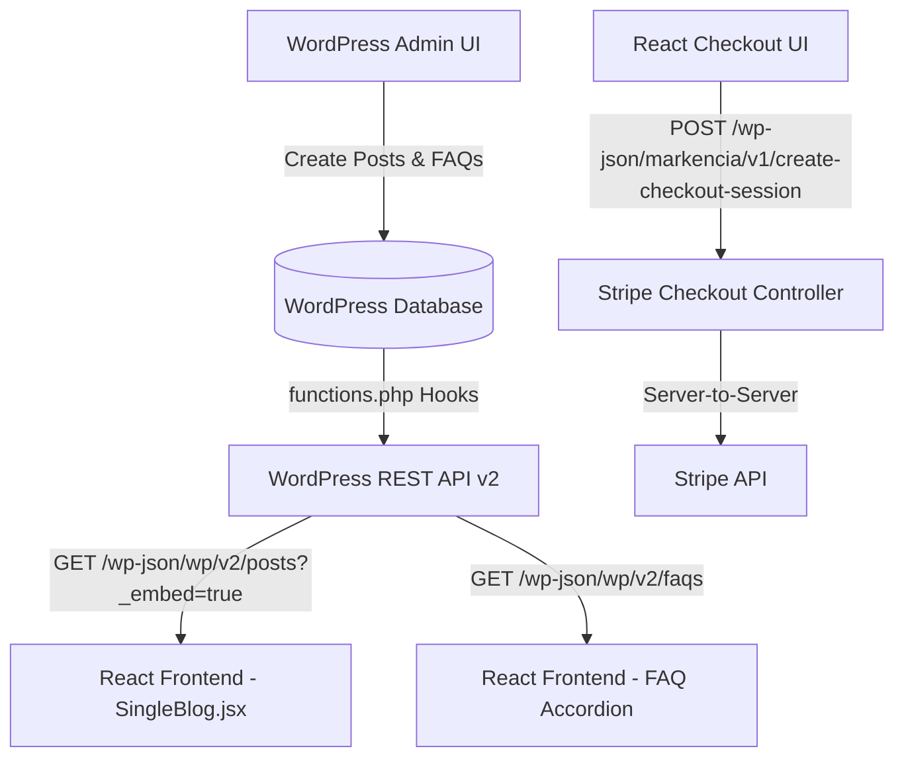

# Markencia — Headless WordPress Theme & Backend CMS

[](https://wordpress.org)
[](https://developer.wordpress.org/rest-api/)
[](http://localhost:5173)

A custom, lightweight **Headless WordPress Theme** built for the **Markencia** enterprise platform. Designed specifically to decouple presentation from backend content management, this theme configures secure CORS headers, registers Custom Post Types (CPTs), integrates Advanced Custom Fields (ACF) into the REST API, and provides custom server-side endpoints for payments and form handling.

---

## 🏗️ Architecture & Data Flow



---

## ✨ Key Features & Backend Capabilities

### 1. 🌐 Secure CORS Header Configuration
* Automatically injects `Access-Control-Allow-Origin`, `Access-Control-Allow-Methods`, and `Access-Control-Allow-Headers` into all WordPress REST API responses (`rest_pre_serve_request` hook).
* Enables frictionless cross-origin requests from the Markencia React Frontend (`http://localhost:5173` or staging/production URLs).

### 2. ❓ FAQ Custom Post Type (`faq`) & ACF Integration
* **Dedicated FAQ Library**: Registers a custom post type `faq` with standard title, editor, and full REST API exposure (`/wp-json/wp/v2/faqs`).
* **ACF FAQ Details**:
  * **`answer` (Textarea)**: The detailed FAQ response.
  * **`faq_category` (Select)**: Categorizes FAQs (General, AI Media Buying, Enterprise Growth, Security & Compliance).
* **Article FAQs Selector**:
  * Adds a **Post Object (`related_faqs`)** field to standard WordPress Blog Posts (`post`).
  * Content writers can hand-pick specific FAQs from the library to attach to individual blog posts.
  * Fully exposed in `/wp-json/wp/v2/posts` when queried with `_embed=true&acf_format=standard`.

### 3. 💳 Stripe Subscription Checkout Endpoint
* Registers a custom REST API route: `/wp-json/markencia/v1/create-checkout-session`.
* Accepts `POST` requests with a Stripe `priceId` from the React pricing page.
* Creates secure server-to-server subscription checkout sessions with Stripe and returns the checkout URL to the frontend.

### 4. 📬 Contact Form 7 Headless Override
* Extends default Contact Form 7 REST API routing to accept alphanumeric form IDs (`(?P<id>[a-zA-w0-9]+)`).
* Allows seamlessly submitting feedback and lead forms from headless React forms directly to CF7.

---

## 🔌 REST API Endpoints Reference

| HTTP Method | Endpoint Path | Description |
| :--- | :--- | :--- |
| `GET` | `/wp-json/wp/v2/posts?_embed=true&acf_format=standard` | Fetch blog posts with embedded author, category, featured image, and ACF `related_faqs`. |
| `GET` | `/wp-json/wp/v2/posts?slug={slug}&_embed=true` | Fetch a single blog post by slug. |
| `GET` | `/wp-json/wp/v2/faqs?_embed=true&acf_format=standard` | Fetch all FAQ items from the Custom Post Type library. |
| `GET` | `/wp-json/wp/v2/faqs?search={keyword}` | Full-text keyword search across FAQ titles and answers. |
| `POST` | `/wp-json/markencia/v1/create-checkout-session` | Create a Stripe recurring subscription Checkout Session (`priceId`). |
| `POST` | `/wp-json/contact-form-7/v1/contact-forms/{id}/feedback` | Submit Contact Form 7 payloads from React. |

---

## 🛠️ Setup & Installation

### 1. Prerequisites & Required Plugins
Ensure the following WordPress plugins are installed and active:
* **Advanced Custom Fields (ACF)** (Free or PRO) — Required for FAQ answer textareas, categories, and Post Object field mappings.
* **Contact Form 7** — Required for lead form submissions.

### 2. Permalinks Configuration
To ensure clean URL slugs (`/blog/your-post-slug/` or `/your-post-slug/`):
1. Navigate to **Settings → Permalinks** in WordPress Admin.
2. Choose **Custom Structure** and set to `/%postname%/` (or `/blog/%postname%/`).
3. Click **Save Changes** to flush rewrite rules.

### 3. Stripe Secret Key Configuration
In `functions.php`, update the Stripe checkout callback with your secret key:
```php
$stripe_secret_key = 'sk_test_YOUR_STRIPE_SECRET_KEY_HERE'; // Replace with live/test key
```

---

## 📁 Theme File Structure

```text
markencia-backend-CMS/wp-content/themes/markencia/
├── functions.php       # Core headless configuration, CPT registration, CORS, Stripe API, & ACF rules
├── style.css           # Theme header definition & minimal reset styles
├── index.php           # Silent fallback template for direct WordPress visits
└── README.md           # Technical documentation (this file)
```

---

## 🚀 Frontend Integration Guide

When fetching a single blog post in React (`src/services/blog/wordpress.js`), always append `_embed=true&acf_format=standard`:

```javascript
// Example: Fetch post by slug with embedded author, category, image, & ACF FAQs
const response = await fetch(
  `http://localhost:8888/markencia/wp-json/wp/v2/posts?slug=${slug}&_embed=true&acf_format=standard`
);
const data = await response.json();
```
